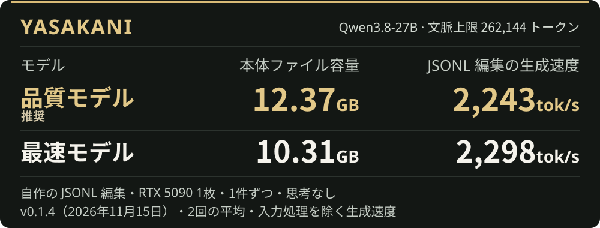

# YASAKANI（ヤサカニ）

[English](README.md) · 日本語

<a name="これは何か"></a>

YASAKANI は Windows PC の RTX 1枚で Qwen3.8-27B を動かす推論エンジンです。開発者が動作を確認したのは RTX 5090 だけです。初回のセットアップのあとは、自分の PC だけでチャットやコード編集ができます。いつもの開発ツールからも OpenAI 互換 API でつなげます。0.3.1 からは、Thinking Machines Lab の Inkling-2 Mini も試験的に動かせます（文章だけ。[詳細](#inkling-2-mini)）。

**[Windows 版をダウンロード](https://github.com/yasakani-dev/yasakani/releases/download/v0.3.1/yasakani-quickstart-0.3.1.zip)** · [8エンジンとの速度比較](docs/MEASUREMENTS.ja.md#思考なしreadme-と同じ表反復等を除いた平均toks) · [コード編集の実演動画](https://github.com/yasakani-dev/yasakani/releases/download/v0.3.1/fast_live_uncut.mp4)

<a name="2-つのモデル"></a>
<a name="必要なもの"></a>
<a name="限界"></a>

## モデルと対応環境



JSONL 編集は自作の課題です。60行の JSONL のうち1行だけ直し、全行を返します。答えのほとんどは入力の写しです。tok/s は1秒あたりに生成したトークン数です。思考なしは、答えの前に考えを書き出さない設定です。測った条件は RTX 5090 1枚・1件ずつ・思考なし・v0.1.4（2026年11月15日）・2回の平均です。入力の読み込みは含みません。ほかの GPU では遅くなります。

普段使いには**品質モデル**をおすすめします。予測が元のモデルに近いモデルです。ファイルの小ささと、多くの課題での速さを優先するなら**最速モデル**を選んでください。**最高品質モデル**（15.72 GB）は、3つの中で元のモデルに最も近いモデルです。24 GB 以上のカードが要り、生成は品質モデルの約 0.8〜0.9 倍の速さです（[詳しく](#max-quality-model)）。[品質モデルの配布ページ](https://huggingface.co/yasakani-dev/Qwen3.8-27B-YASAKANI-quality) · [最速モデルの配布ページ](https://huggingface.co/yasakani-dev/Qwen3.8-27B-YASAKANI-speed) · [最高品質モデルの配布ページ](https://huggingface.co/yasakani-dev/Qwen3.8-27B-YASAKANI-max-quality)

| お使いの GPU | 選べるモデル | Windows での動作確認 |
|---|---|---|
| RTX 5090（32 GB） | 品質・最速・最高品質 | 開発者が実機で検証済み |
| RTX 3090・3090 Ti・4090（24 GB） | 品質・最速・最高品質（最高品質は文脈が短くなる。計算上の値） | 対応ビルドあり。開発者は未検証・最適化なし |
| 対象の RTX 40・50 シリーズ（16 GB） | 最速。文脈長は空きメモリに合わせて調整 | 対応ビルドあり。開発者は未検証・最適化なし |

速さの数字は全て RTX 5090 で測った値です。ほかのカードでは遅くなります。速さと動作は保証しません。編集が速いのは、入力から写した多くのトークンを本体が1回の計算で確認するからです（広い写しの計算。1回で最大64トークン）。0.1.7 からは RTX 30・40・50 で、最初の起動時にカードで確認してから使います。16トークンずつの計算とビット単位で同じ予測になり、そのカードで速い幅だけを使います。普通の文章は速くなりません。速くなるのは編集のように入力を写す答えです。

**入力の読み込み（0.2.0 の新機能）：** RTX 5090 では入力を速く読み込みます。答えは変わりません（[0.2.0 で変わったこと](#020-で変わったこと)）。新しい読み方を標準で使うのは、メモリーが 30,000 MiB 以上のカードだけです。それより小さいカードは 0.1.7 と全く同じ読み方です。小さいカードでも `--prefill new` で新しい読み方を試せます。これは試験的な設定です。RTX 5090 を 24 GB のカードのように設定した時は新しい読み方を使いました。ただし 30,000 MiB 未満の実機では私たちは動かしていません（[小さいカード](docs/FAQ.ja.md#prompt-reading-smaller-cards)）。

**ほかのカードでの報告：** 0.1.7 試験版の結果を、利用者の方が [#24](https://github.com/yasakani-dev/yasakani/issues/24) で報告してくださいました。RTX 4090（Windows 10）では確認で3つの幅が全て開き、編集の3課題が広い計算なしの1.85〜1.99倍の速さでした（770.0 → 1,420.9・822.5 → 1,634.9・793.2 → 1,545.6 tok/s）。出力は同じでした。RTX 5060 Ti では64トークンの幅だけが開きました（215.1 → 279.4・226.9 → 300.4・218.8 → 280.6 tok/s、出力は同じ）。どれも報告者の方の数字です。RTX 30 の報告はまだありません。RTX 30・40 向けのコードを私たちが動かしたのは、RTX 5090 の上だけです。[確認の仕組み](docs/FAQ.ja.md#wide-copy-passes-per-gpu)

Linux には寄稿者が検証したソースビルド手順があります。AMD と Mac は今後の対応目標です。[対象 GPU の型番と要件](docs/FAQ.ja.md#どの-gpuどの-os-で動く) · [Linux のビルド手順](BUILDING.md#linux-building-from-source)

**GPU が複数のとき**：1つのプロセスが使う GPU は1枚です。`--device N` で、`yasakani info` と nvidia-smi が N 番とする GPU を選びます。0.1.5 では GPU が2枚の PC で `--device 1` が `graph instantiate failed` で止まることがありました（[#20](https://github.com/yasakani-dev/yasakani/issues/20)）。0.1.6 で直しを入れました。2026年11月18日に、[#20](https://github.com/yasakani-dev/yasakani/issues/20) の報告者が GPU 2枚（RTX A2000 と RTX 5060 Ti）の PC で直ったことを確かめました。私たち自身は GPU 2枚では試していません。

## 使いはじめ

Windows 11（64 ビット）、Python 3.10 以上、NVIDIA ドライバー 580 以上、Visual C++ 2015–2022 ランタイム（x64）、ディスクの空き 20 GB を用意してください。

1. Windows 起動用 ZIP（v0.3.1）を `C:\yasakani` などの英数字のフォルダーに展開します。[配布ファイルと SHA-256](https://github.com/yasakani-dev/yasakani/releases/tag/v0.3.1)
2. **`START.cmd`** を開いてモデルを選びます。初回はエンジンとモデル一式を取得し、ファイルと GPU の自己点検まで行います。
3. 最後にメニューが出ます。Enter を押すとブラウザーの画面が開き、モデルの読み込みの経過が出ます。読み込みが終わったら質問を入力します。画面のタブは「チャット」「スピード測定」「API 接続」「モデル・状態」の 4 つです。スピード測定はブラウザーの中で測る目安で、標準の測定は `yasakani bench` です。「モデル・状態」には GPU メモリーの使用量が出ます。ダウンロード済みのモデルが 2 つ以上ある時は、ここで切り替えられます。終了ボタンを押すとモデルが止まり、黒い画面も自動で閉じます。
4. 2 回目から（モデルが点検を通ったあと）は、`START.cmd` を開くとこの画面が直接開きます。モデルの質問とメニューは出ません。メニュー（速さを測る・先読みあり・なしを比べる・ターミナルのチャット・サーバーの起動）を出す時は、そのフォルダーのコマンドプロンプトで `START.cmd --menu` と打ちます。

別のアプリから使う時は、画面の「API 接続」のタブに出るアドレスをアプリの接続先にします。通常は `http://127.0.0.1:8765/v1` です。メニューの「サーバーを起動」でも同じ API を使えます。この時は画面を開きません。

ターミナルでは `/effort medium` と入力すると思考が短くなり、`/think off` で思考がオフになります。[手動インストール](python/README.md#install) · [API の使い方](python/README.md#the-server)

**更新。** 0.1.7 から、起動ファイルが自分で更新できます（v0.1.6 以前からは、0.3.1 の起動用 ZIP を一度だけ手で取得してください）。新しい版があるかを GitHub に問い合わせるのは、1 日に 1 回までです（問い合わせる前にそう表示します）。問い合わせるのは、メニューを出す前か、ブラウザーの画面を直接開く前です。新しい版があれば今の版と新しい版を示します。メニューの前では、変える前に必ず聞きます。ブラウザーの画面にも同じ案内と **更新する** のボタンが出ます。画面を直接開く時は黒い画面では聞かず、このボタンを押すまで何も変えません。メニューの「新しい版を確認する」、`START.cmd --action update`、`yasakani update` でも更新できます。モデルはそのまま使い、エンジンと Python のパッケージは入れ直します。前の版に戻す時は `START.cmd --action rollback` です。毎日の確認を止める時は `START.cmd --no-update-check` です。[何を送るか、ファイルをどう確認するか](docs/FAQ.ja.md#更新はどう動く)

<a name="速さ"></a>

## 速度と品質

最速モデルは、7分野すべてで他の8エンジンより速い結果でした。全エンジンを同じ PC の RTX 5090 1枚（定格600 W）で動かし、1件ずつ生成しました。思考なしは反復などを除いた平均、思考ありは課題ごとの最速回で比べています。大きな差が出たのは自作の3課題です。2つは答えの大部分が入力の写しになる編集、1つは規則的な長い JSONL の出力です。この3課題では、思考なしで次に速いエンジンの1.8〜4.6倍でした（コード編集は v0.1.4・11月15日の 2,025 tok/s。MegaCapybara 1.39 Tiny は11月3日の 441 tok/s）。公開されている12問の4分野では1.1〜1.5倍です。12問のうち3問（CUDA のコード、TypeScript のコード、英語の推理小説）は比べていません。最速モデルの答えが反復か指示外のツール呼び出しになったためです。

<a name="020-で変わったこと"></a>

**0.2.0 で変わったこと**（RTX 5090・1件ずつ。公開版の 0.1.7 と比べました）

* **入力の読み込みが速くなりました。** 品質モデルは 8,192 トークンの入力を毎秒 5,153 トークンで読みました（0.1.7 は 4,248、1.21倍）。32,768 トークンでは 4,647 です（0.1.7 は 3,774、1.23倍）。最速モデルは 5,102（4,259）と 4,601（3,774）でした。何も使い回さない最初の読み込みです。思考なしで各版2回の中央値です。文脈長は 69,632 です。思考ありでは、品質モデルがこの2つの長さで1.21倍と1.25倍でした。[詳しく](docs/FAQ.ja.md#prompt-reading-020)
* **読んだことのある長い入力を途中で変えた時は、変えた所の手前の保存した状態から読み直します。** 0.1.7 は最初から読み直していました。32,768 トークンの入力の 25・50・75 % の位置を変えると、品質モデルで1.51倍・2.05倍・4.21倍の速さで読み直しました（最速モデルは1.49倍・2.04倍・4.21倍。条件は同じ）。
* **答えは同じです。** 私たちの確認では、品質モデルと最速モデルで 0.1.7 と同じトークンでした。生成そのものは速くなりません。速度表の15課題（思考なし・全課題の合計・各版3回・置換の再利用は標準のオン）で、0.1.7 と比べて品質モデルは +0.37 %、最速モデルは +0.45 % でした。置換の再利用はこれらの課題を誤差より大きくは速くしません。
* **GPU のメモリーを多く使います。** 最初の長い入力から作業用の領域を持ち続けます。使用量の最大は 0.1.7 より、品質モデルで 1,385〜1,388 MiB、最速モデルで 1,476〜1,479 MiB 多くなりました。GPU にその空きが無い時は `[q35_layer] capacity fallback; no context reduction` を1回表示し、作業用の領域を使わずに読みます（0.2.0 のほかの変更はそのままで、答えは同じです）。標準（`--prefill auto`）で新しい読み方を使うのは 30,000 MiB 以上のカードだけです。それより小さいカードは 0.1.7 と全く同じ読み方です。
* **置換の再利用（新機能、標準でオン）。** 各行のキーや列の名前を変える編集のように、同じ短い置き換えが何度も出る時に効きます。モデルが2か所でその置き換えを書いたあとは、先読みの下書きにその置き換えを入れます。下書きのトークンは全てモデルが確認するので、答えは変わりません。JSONL（80行）の全行でキーの名前を変える課題では、品質モデルで 1,151.4 → 2,039.8 tok/s（1.77倍）でした。SQL（50個のビュー）の全てのビューで列の名前を変える課題では 1,168.5 → 2,101.0 tok/s（1.80倍）です。最速モデルは 1.61倍と 1.60倍でした。条件は文脈長 32,768・温度 1.0・思考なしで、答えの最初の 1,024 トークンを測りました。オフとオンを2回ずつ交互に測った平均です。この2つの課題は `yasakani bench --edit` に入っておらず、入力もこの版には入れていません。置換の再利用は1件ずつ生成する時に働きます。`serve --parallel N` で複数の依頼をまとめた計算では使いません。[詳しく](docs/FAQ.ja.md#edit-copy-020)

どちらも `chat`・`serve`・`bench`・`selfcheck` の設定です。`--prefill auto|new|old`（または `YASAKANI_PREFILL`）と `--edit-copy on|off`（または `YASAKANI_EDIT_COPY`）で変えます。起動時に、どの読み方を使うかとその理由を1行で表示します。[設定の説明](python/README.md#prompt-reading-and-edit-copy) · [測定](docs/MEASUREMENTS.ja.md#measurements-020)

**0.2.0 の新しいモデル：最高品質モデル。** 同じ Qwen3.8-27B を、どの部分も品質モデルより1重みあたり 1 bit 多く変換した物です（15.72 GB）。思考文20本では品質モデルより元のモデルに近く（KL 0.0040 対 0.0126。既定の KV5・RTX 5090）、生成は品質モデルの約 0.8〜0.9 倍の速さです。24 GB 以上のカードが要ります。動作を確認したのは RTX 5090 だけです。起動ファイルでは、モデルの質問の 3 番で選べます。質問が出るのは初回と `START.cmd --menu` の時です。`START.cmd --model max` と打つと、質問なしで選べます。[詳しく](#max-quality-model)

<a name="014-で変わったこと"></a>

**0.1.4 で変わったこと**（思考なし・各課題2回。2026年11月15日に 0.1.2 と続けて測定。RTX 5090、tok/s）

| | コード編集 | JSONL 編集 | 長い JSONL 編集（160件） | ほかの課題 |
|---|---|---|---|---|
| 最速モデル | 1,210 → 2,025（1.67倍） | 1,125 → 2,298（2.04倍） | 1,141 → 2,099（1.84倍） | 0.96〜1.00倍 |
| 品質モデル | 1,128 → 2,008（1.78倍） | 1,146 → 2,243（1.96倍） | 1,096 → 2,056（1.88倍） | 0.97〜1.01倍 |

答えの文章は両方の版で同じでした。例外は 0.1.2 の1回で、途中から文章が変わりました。これは 0.1.3 で直した、まれな問題です。0.1.5・0.1.6 の GPU のコードは 0.1.4 と同じです。0.1.7 は[複数の依頼を同時に処理する](#複数の依頼を同時に)ための GPU のコードを足しました。[詳しく](docs/MEASUREMENTS.ja.md#速さ思考なし)

自分の PC の速さは `yasakani bench` で測れます。上の編集の課題3つ（コード編集・JSONL 編集・長い JSONL 編集）は `yasakani bench --edit` で動かせます。速さ、1回の計算で進んだトークン数、答えが期待どおりかを表示します。[編集の速さの測り方](docs/FAQ.ja.md#編集の速さを自分のパソコンで測るには)

<details>
<summary>7分野の比較表を開く（思考なし・思考あり）</summary>

**思考なし**は各課題2回の平均です。反復や指示外のツール呼び出しが出た回は全エンジン共通の基準で除外しています。YASAKANI は11月15日に v0.1.4 で再測定しました（0.1.5・0.1.6 も GPU のコードは同じ）。単位は入力処理を除く生成 tok/s です。

| エンジン | コード | 物語 | 翻訳 | 構造化 | コード編集 | JSONL 編集 | 長い JSONL |
|---|---|---|---|---|---|---|---|
| **YASAKANI 最速モデル** | **512** | **195** | **479** | 882 | **2,025** | **2,298** | **1,214** |
| **YASAKANI 品質モデル** | 468 | 172 | 464 | **892** | 2,008 | 2,243 | 1,115 |
| MegaCapybara 1.39 Tiny | 465 | 164 | 268 | 599 | 441 | 658 | 666 |
| mkyt v0.3.2 | 395 | 181 | 374 | 555 | 423 | 634 | 639 |
| ignis v0.9.6 | 330 | 167 | 298 | 439 | 331 | 510 | 514 |
| NInfer（11/2 版） | 264 | 123 | 257 | 386 | 295 | 443 | 438 |
| vLLM 0.31.0 | 290 | 148 | 261 | 354 | 241 | 426 | 431 |
| SGLang 0.5.22 | 252 | 129 | 246 | 371 | 430 | 466 | 451 |
| llama.cpp b11700 | 242 | 133 | 232 | 337 | 244 | 360 | 362 |
| TensorFold 0.6.6 | 181 | 104 | 172 | 405 | 383 | 408 | 261 |

**思考あり**は課題ごとの最速回を分野別に集計しました。YASAKANI は11月8日に 0.1.0〜0.1.2 のエンジン（11月7日のビルド）で5回測りました。0.1.4 では測り直していません。比較先は2回から選んでいます。

| エンジン | コード | 物語 | 翻訳 | 構造化 | コード編集 | JSONL 編集 | 長い JSONL |
|---|---|---|---|---|---|---|---|
| **YASAKANI 最速モデル** | **337** | **287** | **497** | **536** | 667 | **1,108** | **704** |
| **YASAKANI 品質モデル** | 299 | 242 | 428 | 480 | **743** | 1,053 | 634 |
| MegaCapybara 1.39 Tiny | 290 | 206 | 308 | 429 | 550 | 663 | 516 |
| mkyt v0.3.2 | 244 | 196 | 348 | 384 | 378 | 603 | 454 |
| ignis v0.9.6 | 211 | 130 | 276 | 277 | 278 | 485 | 327 |
| NInfer（11/2 版） | 172 | 140 | 258 | 263 | 263 | 404 | 322 |
| vLLM 0.31.0 | 131 | 112 | 197 | 195 | 187 | 369 | 253 |
| SGLang 0.5.22 | 157 | 124 | 206 | 230 | 257 | 402 | 282 |
| llama.cpp b11700 | 140 | 122 | 184 | 197 | 206 | 349 | 221 |
| TensorFold 0.6.6 | 134 | 79 | 167 | 183 | 439 | 360 | 268 |

比較先は11月3日・6日に測りました。重み・量子化・KV・高速化は、各エンジンの設定のままです。[測定条件・全回平均](docs/MEASUREMENTS.ja.md) · [再現用の記録とスクリプト](bench/README.ja.md)

</details>

<a name="コード編集を最後まで"></a>

11月8日のカットなし録画では、最速モデルが Python ファイルを編集し、送信から **5.56 秒**で全文を返しました。編集後のコードは、17,701件のテスト入力で元のプログラムと同じ結果を返しました。[時計付きの録画と検証記録](bench/20261108/demo/README_JA.md)

<a name="品質"></a>

次のトークンの第1候補が元の BF16 モデルと一致した割合は、品質モデルが **95.24%**、最速モデルが **93.01%** でした。測ったのは、変換に使っていない思考文20本（20,460か所）です。KL は、予測の確率が元のモデルとどれだけ違うかを表す値で、小さいほど近いことを示します。品質モデルは 0.0122、最速モデルは 0.0304 でした。同じ容量帯の GSQ-RCO IQ3_S は 93.64% です。これらは11月8日に研究用のビルドと FP16 KV で測った値です。公開版のエンジン（0.1.0〜0.1.2、KV5）で11月14日に測り直すと、95.35%（KL 0.0126）と 92.98%（KL 0.0309）でした。これは思考文で元のモデルと同じ語を選ぶ割合で、課題の正答率ではありません。元のモデルと完全に同じでもありません。[13構成の品質比較と測定方法](docs/MEASUREMENTS.ja.md#思考文の品質比較) · [自分で測る](tools/quality/)

<a name="max-quality-model"></a>

**最高品質モデル。** 同じ Qwen3.8-27B を、より多くのビットで変換した物です。本体は1重みあたり 5 bit と 4 bit、出口の行列は 5 bit、埋め込みの表は 4 bit です（15.72 GB。どの部分も品質モデルより1重みあたり 1 bit 多い）。既定の KV5 で同じ方法で測ると（RTX 5090、2026年11月20日）、第1候補が元のモデルと一致した割合は **97.40%**、KL は 0.0040 でした。品質モデルは同じ測り方で 95.35% と 0.0126 です。同じ PC で品質モデルと比べると、入力の読み込みと編集3課題は 0.97〜1.00 倍の速さでした。`yasakani bench` の4課題は、思考なしで 0.92 倍（403.4 対 439.3 tok/s）、思考ありで 0.81 倍（317.9 対 392.4 tok/s）でした。動作を確認したのは RTX 5090 だけです。24 GB のカードでは、画面が 500 MiB を使う時に、パッケージが文脈を 163,840 トークン（GPU をほかに使わない時は 196,608）に決める計算です。実機では確認していません。16 GB のカードには入りません。YASAKANI 0.2.0 以降が要ります。それより前の版は、5 bit の符号を開く時にエラーで止まります。[測定](docs/MEASUREMENTS.ja.md#max-quality-model)

<a name="長い文脈"></a>

文脈上限の262,144トークン分を確保すると、GPU メモリの使用量は品質モデルで約21.2 GiB、最速モデルで約19.1 GiB でした。補助モデルの分も含みます。最高品質モデルは、0.2.0 のパッケージで読み込んだ後に 25,977 MiB を使いました（同じ測定で品質モデルは 22,795 MiB）。0.2.0 の新しい入力の読み方では、作業用の領域の分がこれに加わります（[上](#020-で変わったこと)）。長文での品質は128Kまで測っています。[KV5 の長文測定](docs/MEASUREMENTS.ja.md#最速モデルのkv5独自圧縮のキーバリューキャッシュ)

<a name="複数の依頼を同時に"></a>

## 複数の依頼を同時に処理する（試験的）

0.1.7 で足した機能です。サーバーは GPU 1枚で複数の依頼を同時に生成できます。依頼ごとに文脈を持ち、モデルの1回の計算で動いている依頼をまとめて進めます。

```bat
yasakani serve --model-dir D:\models\qwen38-quality --parallel 4
```

既定は `--parallel 1` で、今までどおり1件ずつです。この版と GPU のコードが同じ開発中のビルドで確かめました（RTX 5090、両モデル、思考なし）。`--parallel 1` のトークンは各モデル35問で 0.1.5 と同じで、15課題の速さの差は 0.1.5 と比べて1%以内でした。

`--parallel N` でも、各答えのトークンはその会話だけを同じ設定の新しいサーバーに送ったときと同じです。条件は、依頼が自分の `seed` を持つことと、入力の読み方（`timings.snap_mode`）が同じことです。

制限：

* 試験的な機能です。試したのは RTX 5090（32 GB）だけです。
* 編集は遅くなります。コード編集と JSONL 編集では、2〜16件を同時に流すと1件ずつ送るときの0.42〜0.59倍の速さでした。公開の12問は16件同時で1.1〜6.6倍でした（最速モデル、思考なし）。
* 入力を読む間と画像つきの依頼の間は、ほかの依頼がすべて止まります。16,533トークンを読むのに約4.1秒かかります。
* 文脈が短くなります。RTX 5090 で品質モデルを N=4 にすると、1件あたり114,688トークンでした。
* 0.2.0 の新しい入力の読み方：空きを残す `--max-ctx` を指定した時は使いました（RTX 5090 で `--parallel 4 --max-ctx 16384`）。`--parallel N` が文脈長を自分で決める時は、GPU の空きメモリーを使い切ります。その時はエンジンが空きを見つけられず、作業用の領域を使わない読み方になることがあります。これは測っていません。
* `seed` のない依頼は、届いた順番で結果が変わります。

[よくある質問と測定](docs/FAQ.ja.md#複数の依頼を同時に処理する試験的)

<a name="inkling-2-mini"></a>

## Inkling-2 Mini（試験的。0.3.1 の新機能）

Inkling-2 Mini は、Thinking Machines Lab が 2026 年 11 月 20 日に公開した言語モデルです（[thinkingmachines/Inkling-2-Mini](https://huggingface.co/thinkingmachines/Inkling-2-Mini)）。重みは 264 億個で、専門家を組み合わせる形です。各層は 128 個の専門家から、トークンごとに 8 個を選びます。ライセンスは Apache-2.0 です。モデルカードには利用の規定（[Model Acceptable Use Policy](https://thinkingmachines.ai/model-acceptable-use-policy/)）も書かれています。この規定は重みと、手を加えた版に適用されます。YASAKANI は、エンジンの ZIP に入れた 2 つ目のライブラリでこのモデルを動かします。Qwen3.8-27B のモデルは、これまで通り `yskn.dll`（0.2.0 と同じファイル）で動きます。

必要な物は次の 3 つです：Windows 11（64 ビット）・24 GB 以上の NVIDIA RTX のカード・YASAKANI 0.3.1 の起動ファイルかパッケージ。24 GB 未満のカードにはモデルが入りません。ダウンロードにはディスクの空きが約 20 GB 要ります。変換のプログラムは、同じドライブなら重みのファイルを新しいフォルダーにリンクするので、空きはほとんど減りません（別のドライブではコピーします）。下の手順は Windows の物です。Linux では、[#28](https://github.com/yasakani-dev/yasakani/pull/28) で寄稿された別のエンジンで動きます。`-DYSKN_WITH_INK2=ON` を付けてソースから組み立て、ダウンロードしたフォルダーを変換せずに読みます（[BUILDING.md](BUILDING.md#linux-inkling-2)、英語）。

1. 公開されているモデルを、Hugging Face のコマンド（`hf`）でダウンロードします。`hf` は Python のパッケージ `huggingface_hub` に入っています。版は私たちが確認した物を指定します。
2. この版のソースにある `tools/convert/inkling2_convert.py` で変換します（公開ページのソースコードの ZIP か、このリポジトリの複製）。標準の設定では重みを変えません。パッケージが使うファイルを隣に作るだけです（各ファイルの SHA-256 を書いた `yasakani.json`・`selfcheck.json`・`NOTICE`）。ダウンロードに入っている画像の部分は使いません。先読み用のモデル（`mtp.safetensors`）は、重みと同じようにフォルダーにリンクかコピーします。
3. フォルダーを確認してから、チャット・サーバー・ブラウザーの画面のどれかを起動します。

起動ファイルのフォルダーでは、コマンドプロンプトで先に `yasakani_env.cmd` を実行します。起動ファイルの `python` と `yasakani` が使えるようになります。

```bat
cd /d C:\yasakani
yasakani_env.cmd
hf download thinkingmachines/Inkling-2-Mini --revision ed40e7da625f594fc9c4990f5f66be24873c22d7 --local-dir D:\models\Inkling-2-Mini-hf
python C:\src\yasakani-0.3.1\tools\convert\inkling2_convert.py --source D:\models\Inkling-2-Mini-hf --out D:\models\inkling2-mini
yasakani verify --model-dir D:\models\inkling2-mini
yasakani selfcheck --model-dir D:\models\inkling2-mini
yasakani chat --model-dir D:\models\inkling2-mini
yasakani serve --model-dir D:\models\inkling2-mini
START.cmd --model-dir D:\models\inkling2-mini
```

変換のプログラムは、起動ファイルの Python で動かします（`yasakani_env.cmd` で使えるようになる `python`）。変換には numpy・tokenizers・jinja2 が要り、どれもパッケージと一緒にそこに入っています。エンジンのライブラリ `yskn_inkling2.dll` は、コマンドが自分で見つけます。起動ファイルのエンジンのフォルダーで `yskn.dll` の隣にあり、`yasakani_env.cmd` がその `yskn.dll` を指定するからです。`--dll` は、ライブラリを別の場所に置いた時だけ指定します（`yskn_inkling2.dll` か、隣にある `yskn.dll` の場所）。

`selfcheck` は、transformers のライブラリにあるこのモデルの公式の試験（文章）と同じ入力を使います。貪欲法で出した 30 トークンを、その試験の期待値と比べます。`serve` は Qwen のモデルと同じ OpenAI 互換の API で、モデルの ID は `inkling-2-mini` です。`START.cmd --model-dir` は、このフォルダーのモデルでブラウザーの画面を開きます。起動のたびに、先にフォルダーの `info`・`verify`・`selfcheck` をします。私たちの環境では、確認と画面の起動で 35〜40 秒でした（ファイルが Windows のキャッシュにある時）。`START.cmd` のほかの指定は今まで通り使えます。

**速さ**（RTX 5090 1枚・Windows 11・2026 年 11 月 21 日・公開の重み・1件ずつ）：貪欲法・思考なし・256 トークンの生成は、`yasakani bench --draft off` で 166.3 tokens/s でした（4 回の平均。同じ回のエンジン単体は 165.6 tokens/s）。標準の `--draft auto`（下の先読み）では 207.7 tokens/s でした。ターミナルのチャット（思考あり・effort low・`--draft auto`）は 155.7 tokens/s でした（日本語の質問 1 つ・207 トークン）。サーバーの逐次の出力は 174 tokens/s で（日本語の短い質問・思考ありで 145 トークン）、最初の出力まで 0.08 秒でした。長い会話では遅くなります。位置 1,024 からは、1 トークンに 7.3〜7.5 ms かかりました（133〜138 tokens/s）。入力の読み込み：パッケージを通して、4,056 トークンの入力で 1,000 tokens/s、1,011 トークンで 1,090 tokens/s でした（空の文脈から各 3 回）。エンジン単体では、1,000〜4,000 トークンで 950〜1,050 tokens/s、16,000 トークンで 760〜860 tokens/s です。前の入力と同じ始まりの入力（チャットの次の番）では、新しい部分だけを読みます。起動から使えるまでは、先読みなしで 6.4 秒、先読みありで 8.4 秒でした（ファイルが Windows のキャッシュにある時）。標準の文脈 32,768 トークンでは、エンジンが GPU のメモリーを 22.1 GB 確保しました（うち KV キャッシュが 2.15 GB）。先読みありでは 23.2 GB です。文脈は `--max-ctx` で変えられます。長くするとキャッシュも増えます。

**答え。** RTX 5090 で、私たちのエンジンは公式の試験が期待する 30 トークンを出しました。私たちが CPU で書いたこのモデルの実装とも一致しました（隠れ状態の差は 1e-4 以内で、選んだ専門家も同じ）。測ったのは公開のモデルとの一致だけです。課題の正答率は測っていません。

**先読み用のモデル。** 0.3.1 から、モデルに付いている先読み用のモデル（`mtp.safetensors`）を使います。このモデルが次の数トークンを予想し、本体がそれを 1 回の計算でまとめて確認します。本体が選ばないトークンは捨てるので、出力は変わりません。貪欲法では同じトークンになります。サンプリングでも、各トークンを選ぶ確率は同じです。使い方は `--draft` で選びます。標準の `auto` は、生成が速くなる間だけ使います。`on` は常に使います。`off` は読み込みません。環境変数 `YASAKANI_DRAFT` でも同じ設定ができます。1 回に予想するトークンの数は `--draft-depth N`（1〜7）で変えられます。起動時の表示に、読み込んだかどうかと使い方が出ます。このファイルが無いフォルダーでも、先読みなしで動きます。

先読みありの速さ（RTX 5090 1枚・Windows 11・2026 年 11 月 21 日・貪欲法・入力ごとに 200 トークン）。エンジンと Python の結び付けで、1 回の測定にまとめて測りました。入力の数は、日本語の文章とコードが 2 つずつ（どちらも 1 つは思考あり）です。JSON は 1 つ、数学は思考ありの 1 つです。1 回の計算で出たトークンは `--draft auto` の値です。

| 文の種類 | 公開の重み・`--draft off` | 公開の重み・`--draft auto` | `--scheme quality`・`--draft off` | `--scheme quality`・`--draft auto` | 1 回の計算で出たトークン（公開 / quality） |
|---|---|---|---|---|---|
| 日本語の文章 | 164.3 tokens/s | 162.3 tokens/s | 202.8 tokens/s | 195.4 tokens/s | 1.28 / 1.11 |
| コード | 164.4 tokens/s | 200.8 tokens/s | 203.1 tokens/s | 211.4 tokens/s | 2.35 / 1.76 |
| JSON | 164.1 tokens/s | 260.4 tokens/s | 202.7 tokens/s | 256.9 tokens/s | 3.88 / 3.57 |
| 数学 | 164.8 tokens/s | 177.8 tokens/s | 203.7 tokens/s | 212.8 tokens/s | 1.72 / 1.54 |

英語の入力 1 つも足した 7 つの合計では、`--draft auto` は公開の重みで 186.0 tokens/s（先読みなしは 164.4）、`--scheme quality` の重みで 210.1 tokens/s（同 203.0）でした。どの回でも、貪欲法の出力は先読みのありとなしで 1 トークンずつ同じでした（深さ 1〜7 と `auto` の全部）。予想が当たりにくい文では `auto` が少し遅くなります。`--scheme quality` の重みでは、日本語の文章が 3.6% 遅く、英語の文章 1,000 トークンが 2.8% 遅くなりました（182.9 と 188.2 tokens/s）。`yasakani bench`（その 4 つの入力・思考なし・256 トークン・4 回の平均・上と同じ回）では、公開の重みが `--draft off` で 166.3、`--draft auto` で 207.7 tokens/s でした。`--scheme quality` は 209.4 と 213.9 tokens/s です。

先読みが良く効くのは、次のトークンを予想しやすい文です（コード・JSON・数学）。`yasakani chat` と `yasakani bench` は、1 回の計算で出たトークンの数も表示します。サーバーは `timings` に入れて返します（`tokens_per_pass`・`draft_passes`・`draft_n`・`draft_n_accepted`）。

**小さくした重み（`--scheme quality`）。** 変換のプログラムは、重みを少ないビット数で書き直すこともできます。`--scheme quality` では、密な行列の多くを 4 ビットか 8 ビットにします。層 20〜23 の 8 ビットの専門家は 4 ビットに詰め直します。できるのは 15.05 GB の `.yskn` のファイル 1 つです（公開のファイルは 19.5 GB）。公開のモデルと 43 個の文章（14,024 か所。モデル自身の思考と答え・英語と日本語の文章・コード）で比べると、KL ダイバージェンスは 0.0110 でした。次に最も出やすいトークンは 96.0% の位置で同じでした。エンジンはこれらの行列を書いてある形のまま掛けるので、速くなり、GPU のメモリーも減ります。RTX 5090 の 1 回の測定（`yasakani bench --draft off`・貪欲法・思考なし・256 トークン・4 回の平均）では 209.4 tokens/s で、公開の重みは 166.3 tokens/s でした。標準の `--draft auto` では 213.9 と 207.7 tokens/s です。標準の文脈 32,768 トークンでのエンジンの確保は 22.1 GB から 18.3 GB に減ります（先読みありでは 23.2 GB から 19.4 GB）。パッケージを通した入力の読み込みは少し遅く、4,056 トークンで 925 tokens/s（公開の重みは 998）、1,011 トークンで 1,002 tokens/s（同 1,090）でした（各 3 回）。起動から使えるまでは、先読みなしで 2.5 秒、先読みありで 7.2 秒でした（先読み用のモデルは読み込む時に CPU で準備します）。変換は CPU で約 4 分です。新しいフォルダーにはディスクが約 15 GB 要ります。

```bat
python C:\src\yasakani-0.3.1\tools\convert\inkling2_convert.py --source D:\models\Inkling-2-Mini-hf --out D:\models\inkling2-mini-quality --scheme quality
yasakani verify --model-dir D:\models\inkling2-mini-quality
yasakani selfcheck --model-dir D:\models\inkling2-mini-quality
yasakani chat --model-dir D:\models\inkling2-mini-quality
START.cmd --model-dir D:\models\inkling2-mini-quality
```

`verify` は、各ファイルを SHA-256 で、各テンソルを CRC-32 で比べます。`selfcheck` は短い入力 3 つ（英語・日本語・コード）で、貪欲法の 48 トークンずつを期待値と比べます。期待値は、このモデルの参照の実装が、変換したこの重みで出したトークンです。重みはエンジンが掛けるのと同じ値に戻しました。入力は、48 トークンのどこでも、選ばれたトークンが次の候補よりロジットで 0.11 以上大きい物を選びました（参照の実装でも私たちのエンジンでも）。ほかの GPU で計算の細かい差が出ても結果が変わらないためです。確認したのは RTX 5090 だけです。CPU での変換は、毎回同じファイルになります。`.yskn` のファイルが私たちの変換（版 `ed40e7da625f594fc9c4990f5f66be24873c22d7` から。SHA-256 は `44ef7ea5eade7a1e6cfb4f7ad3f7568a701ce9c621f7e4d00d38b624f4de138d`、15,052,423,172 バイト）と同じなら、変換のプログラムは期待値を `selfcheck.json` に書きます。`START.cmd --model-dir` も、公開の重みと同じようにこのフォルダーを確認します。ファイルが違う時（たとえば別の版から変換した時）は、`selfcheck.json` を空のまま書きます。その時は `selfcheck` に比べる物がありません。`START.cmd --model-dir` で開く時は `--skip-checks` を付けてください（付けないと自己確認で止まります）。

**ツール呼び出し。** 0.3.1 の新機能です。Inkling-2 のフォルダーで `yasakani serve` を使うと、`tools` を受け付けます。モデルの呼び出しは `tool_calls`（finish_reason は `tool_calls`）で返します。ストリームのありとなしのどちらでも使えます。1回の返事に複数の呼び出しも入ります。`tool_choice` は `auto`・`none`・`required`・関数名の指定を受け付けます。モデルは自分の書式で呼び出しを書き、サーバーがそれを読みます。読めない塊は本文として返します。結果は `tool_call_id` を付けた `tool` のメッセージで送り返してください。ツールありで思考なしの時も、モデルは少し考えます（私たちの測定では 34〜85 トークン。`reasoning_content` に出ます）。この時は思考の量を 0 にして返事を始め、答えか呼び出しの頭をモデル自身に書かせるためです。RTX 5090 1枚と `--scheme quality` のフォルダーで、呼び出し1つ・呼び出しと結果と答え・1回の返事に2つ・ストリーム・`tool_choice` の4種類を流しました。

**制限。** 0.3.1 では試験的な対応です。

* 文章だけです（元のモデルは画像も読めます）。
* 依頼は 1件ずつです。`--parallel` は使えません。
* ツール呼び出しは `yasakani serve` だけです。ターミナルのチャットでは使えません。ツールを使う会話は、サーバーの文脈（標準は 32,768 トークン）で止まります。入りきらない依頼にはエラー（HTTP 400）を返すので、新しい会話を始めてください。思考ありで長く考えると、呼び出しを書く前に `max_tokens` を使い切ることがあります。`thinking_budget`（依頼の項目か環境変数 `YASAKANI_THINKING_BUDGET`）を付けると、その数のトークンで思考を切ります。
* 多くのアプリは前の返事の思考を送り返しません。そのため次の依頼では前の返事を捨てます。エンジンは 512 位置までなら、会話を読み直さずに捨てられます（`YASAKANI_INK2_ROLLBACK`。0 でエンジンの標準の 64）。その分 GPU のメモリーが増えます。`--scheme quality` のフォルダーと文脈 32,768 では、エンジンの確保が 19.4 GB から 20.0 GB になり、GPU 全体では 0.8 GB 増えました。
* 先読みは、自由な文章より予想しやすい文で良く効きます。効かない所では `--draft auto` が先読みをやめます。それでも時々試すので、少し遅くなります（私たちの測定では日本語の文章で最大 3.6%）。`--draft off` ならこの分は掛かりません。
* このモデルでは `bench --edit` と画像入力も使えません。
* Windows で確認したのは RTX 5090 1枚と Windows 11 だけです。ほかの GPU では試していません。Linux では [#28](https://github.com/yasakani-dev/yasakani/pull/28) のエンジンだけを使い、ソースから組み立てます。私たちは RTX 5090 1枚の WSL2 で動かしました。寄稿者の方は RTX 5090 と DGX Spark で動かしています（[BUILDING.md](BUILDING.md#linux-inkling-2)）。
* 思考なしは私たちの設定です（[よくある質問](docs/FAQ.ja.md#inkling-2-mini)）。

[よくある質問](docs/FAQ.ja.md#inkling-2-mini) · [コマンドと設定（英語）](python/README.md#inkling-2-mini-experimental)

## コミュニティの変換

[tools/convert/](tools/convert/) の変換器でほかの人が作ったファイルです。**このプロジェクトは確かめておらず、保守もしていません**。
動く状態に保つのは下に名前のある人です。新しい版に追いつかなくなった変換は、その版でこの一覧から外すことがあります。

**Arete-27B**（作成：[@audreyt](https://github.com/audreyt)）：Nous Research が Qwen3.8-27B をファインチューンした [NousResearch/Arete-27B](https://huggingface.co/NousResearch/Arete-27B) を、
コミュニティで変換したものです。品質モデルと同じ設定で作り、品質モデルの下書きモデルをそのまま使います。ファイルは
[audreyt/Arete-27B-YASAKANI-quality](https://huggingface.co/audreyt/Arete-27B-YASAKANI-quality/tree/659effbdf9dc103fcc053e3da7858bcff7f14cc9) のリビジョン `659effb` です。
全ファイルの SHA-256 はその `SHA256SUMS` にあります（モデルファイル `arete_quality.yskn`、12,365,242,368 バイト、
`541c9206ede621bd92e78ff09f838fca5e4660d834fa883b3d20cdb4ab56880a`）。

```bat
hf download audreyt/Arete-27B-YASAKANI-quality --revision 659effbdf9dc103fcc053e3da7858bcff7f14cc9 --local-dir D:\models\arete-quality
yasakani selfcheck --model-dir D:\models\arete-quality --dll D:\yasakani\yskn.dll
```

そのあとは [使いはじめ](#使いはじめ) と同じように `--model-dir D:\models\arete-quality` を付けて使います。次の値は、この変換を作った人が RTX 5090 で測ったものです。

* 元の BF16 の Arete-27B との近さ（`tools/quality/`、思考文 20 本、KV5 のキャッシュ、0.1.3 で測定）：KL 0.0116、第 1 候補一致率 95.64%。
  品質モデルを同じ方法で Qwen3.8-27B と比べた値は 0.0126 と 95.35% です。
* 0.1.4 で：`yasakani verify` は 11 ファイル中 11 ファイル、`yasakani selfcheck` は 3 件中 3 件が合格（出力は 0.1.3 と同じ）。
  先読みの 1 回の計算で進んだトークン数は、文章 2.40・思考あり 2.48・コード 4.68・CSV → JSON 15.04 です。思考文では品質モデルより少なく、作った人が同じカードと 0.1.3 で両方を測ると 2.48 対 3.24 でした。
  そのため思考文では、上の速さの表の値より遅くなると考えてください。
* そのほかの評価は、設定と注意点とともに[モデルカード](https://huggingface.co/audreyt/Arete-27B-YASAKANI-quality/tree/659effbdf9dc103fcc053e3da7858bcff7f14cc9)にあります。

**Arete-27B-pi**（作成：[@audreyt](https://github.com/audreyt)）：Arete-27B に harness-hub の pi 用コーディングアダプターを合成してから変換したものです。
[モデルカード](https://huggingface.co/audreyt/Arete-27B-pi-YASAKANI-quality/tree/7a0670eaa25753ed82aa1e31f1d943d6ff582be0)
（リビジョン `7a0670e`、モデルファイル `arete_pi_quality.yskn`、12,365,242,368 バイト、`49676c4ad01a9714fc35f74c9c4f6bb18d9367911f2453eab6b44798d907f75b`）に、
pi での設定方法と、この変換を作った人が RTX 5090（Linux）と YASAKANI 0.1.4 で測った結果があります。
`verify` は 11 ファイルすべてが一致し、`selfcheck` は 3 件すべてが合格しました。合成後の BF16 のモデルとの近さは、
品質の道具で KL 0.01127、第 1 候補一致率 95.57% でした（思考文 20 本・20,460 位置、KV5 のキャッシュ）。

<a name="仕組みかんたんに"></a>
<a name="ドキュメントと開発参加"></a>

## 開発と支援

YASAKANI はモデルの圧縮形式と GPU の計算を一緒に設計しています。コード編集では、入力からそのまま写せそうな部分を本体が1回の計算でまとめて確かめます。そのため、変えていない行を書き戻す時間が短くなります。[技術解説](docs/TECHNOLOGY.ja.md) · [ファイル形式](docs/FORMAT.ja.md) · [変換ツール](tools/convert/)

<a name="エージェントとして使う"></a>

ソースからのビルド手順と、GPU の動作報告の方法を公開しています。ブラウザーで使うエージェント画面も試せます（任意。GPU のメモリ 24 GB 以上。旧版のサーバーが入っています）。[ビルド](BUILDING.md) · [開発に参加](CONTRIBUTING.md) · [エージェントの導入](harness/HARNESS_README.txt)

<a name="支援"></a>

このエンジンは日本で開発しています。ご支援は、まず24 GB・16 GB の RTX の実機での検証と調整に充てます。掲載を希望した方は、このリポジトリと今後の版の起動時クレジットでご紹介します。[CAMPFIRE（日本在住の方）](https://camp-fire.jp/projects/992233/view) · [GitHub Sponsors](https://github.com/sponsors/yasakani-dev)

<a name="ライセンス"></a>

Apache License 2.0 で公開しています。[ライセンス](LICENSE) · [著作権表示](NOTICE) · [第三者の著作物](THIRD_PARTY_NOTICES.md) · [更新履歴と寄稿者](docs/RELEASE_NOTES.ja.md)
