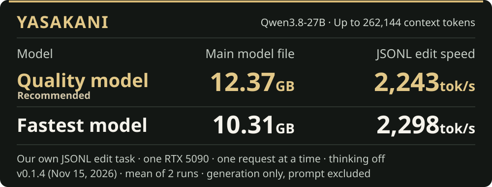

# YASAKANI

English · [日本語](README.ja.md)

YASAKANI runs Qwen3.8-27B on a Windows PC with one NVIDIA RTX GPU. After setup you can chat and edit code offline, or connect your development tools to its OpenAI-compatible API.

**[Download for Windows](https://github.com/yasakani-dev/yasakani/releases/download/v0.1.5/yasakani-quickstart-0.1.5.zip)** · [Compare eight engines](docs/MEASUREMENTS.md#thinking-off-the-table-of-the-readme-average-without-repetition-loops-etc-toks) · [Watch an uncut code edit](https://github.com/yasakani-dev/yasakani/releases/download/v0.1.5/fast_live_uncut.mp4)

## Models and hardware

Choose the **quality model** for everyday use and predictions closest to the original model. Choose the **fastest model** for its smaller file and higher generation speed. [Quality model download](https://huggingface.co/yasakani-dev/Qwen3.8-27B-YASAKANI-quality) · [Fastest model download](https://huggingface.co/yasakani-dev/Qwen3.8-27B-YASAKANI-speed)

| Your GPU | Model choice | Windows testing |
|---|---|---|
| RTX 5090 (32 GB) | Quality or fastest | Tested by the developer |
| RTX 3090, 3090 Ti, or 4090 (24 GB) | Quality or fastest | Included in the build, awaiting testing on these GPUs |
| Listed RTX 40 and 50 series cards (16 GB) | Fastest, with context sized to free memory | Included in the build, awaiting testing on these GPUs |

Contributors have tested a Linux build from source. AMD and Mac are future targets. [GPU list and requirements](docs/FAQ.md#which-gpus-which-systems) · [Build on Linux](BUILDING.md#linux-building-from-source)

## Quick start

You need 64-bit Windows 11, Python 3.10 or later, NVIDIA driver 580 or later, the Visual C++ 2015–2022 x64 runtime, and 20 GB of free disk space.

1. Extract the v0.1.5 Windows quickstart ZIP to a simple path such as `C:\yasakani`. [Release files and SHA-256 checksums](https://github.com/yasakani-dev/yasakani/releases/tag/v0.1.5)
2. Open **`START.cmd`** and choose a model. The launcher downloads the engine and model files, verifies them, and runs the GPU self-check.
3. Select browser or terminal chat and enter your first prompt. To use another app, start the server and point the client at `http://127.0.0.1:8765/v1`.

In terminal chat, enter `/effort medium` for a shorter thinking phase or `/think off` to turn it off. [Manual installation](python/README.md#install) · [API guide](python/README.md#the-server)

## Speed and quality

All engines generated one request at a time on the same PC with one stock RTX 5090 (600 W). The fastest model led the eight other engines in all seven categories using filtered means with thinking off and the best run per task with thinking on. The largest gains came from edits that copy much of the input. On the code edit the fastest model generated **2,025 tok/s** and MegaCapybara 1.39 Tiny generated **441 tok/s**.

See all seven categories with thinking off and on

**Thinking off** uses the two-run mean for each task, excluding repetition loops and unrequested tool calls by the same rule for all engines. YASAKANI was measured again on November 15 with v0.1.4. Numbers are generation tok/s, excluding prompt processing.

| Engine | Code | Story | Translation | Structured | Code edit | JSONL edit | Long JSONL |
|---|---|---|---|---|---|---|---|
| **YASAKANI fastest model** | **512** | **195** | **479** | 882 | **2,025** | **2,298** | **1,214** |
| **YASAKANI quality model** | 468 | 172 | 464 | **892** | 2,008 | 2,243 | 1,115 |
| MegaCapybara 1.39 Tiny | 465 | 164 | 268 | 599 | 441 | 658 | 666 |
| mkyt v0.3.2 | 395 | 181 | 374 | 555 | 423 | 634 | 639 |
| ignis v0.9.6 | 330 | 167 | 298 | 439 | 331 | 510 | 514 |
| NInfer (November 2 build) | 264 | 123 | 257 | 386 | 295 | 443 | 438 |
| vLLM 0.31.0 | 290 | 148 | 261 | 354 | 241 | 426 | 431 |
| SGLang 0.5.22 | 252 | 129 | 246 | 371 | 430 | 466 | 451 |
| llama.cpp b11700 | 242 | 133 | 232 | 337 | 244 | 360 | 362 |
| TensorFold 0.6.6 | 181 | 104 | 172 | 405 | 383 | 408 | 261 |

**Thinking on** takes the fastest run per task and averages within each category. YASAKANI was measured on November 8 with the earlier engine, using five runs per task. The other engines had two.

| Engine | Code | Story | Translation | Structured | Code edit | JSONL edit | Long JSONL |
|---|---|---|---|---|---|---|---|
| **YASAKANI fastest model** | **337** | **287** | **497** | **536** | 667 | **1,108** | **704** |
| **YASAKANI quality model** | 299 | 242 | 428 | 480 | **743** | 1,053 | 634 |
| MegaCapybara 1.39 Tiny | 290 | 206 | 308 | 429 | 550 | 663 | 516 |
| mkyt v0.3.2 | 244 | 196 | 348 | 384 | 378 | 603 | 454 |
| ignis v0.9.6 | 211 | 130 | 276 | 277 | 278 | 485 | 327 |
| NInfer (November 2 build) | 172 | 140 | 258 | 263 | 263 | 404 | 322 |
| vLLM 0.31.0 | 131 | 112 | 197 | 195 | 187 | 369 | 253 |
| SGLang 0.5.22 | 157 | 124 | 206 | 230 | 257 | 402 | 282 |
| llama.cpp b11700 | 140 | 122 | 184 | 197 | 206 | 349 | 221 |
| TensorFold 0.6.6 | 134 | 79 | 167 | 183 | 439 | 360 | 268 |

The other engines were measured on November 3 and 6. Each engine used its own weights, quantization, KV cache and acceleration settings. [Measurement conditions and all-run averages](docs/MEASUREMENTS.md) · [Records and reproduction scripts](bench/README.md)

In the uncut November 8 recording, the fastest model edited a Python file and returned the full file **5.56 seconds** after submission. The edited code matched the original program’s behavior on 17,701 test inputs. [Recording and verification records](bench/20261108/demo/)

On 20 held-out reasoning texts, the quality model agreed with the original BF16 model’s top next token at **95.24%** of 20,460 positions. The similarly sized GSQ-RCO IQ3_S agreed at **93.64%**. YASAKANI used an FP16 KV cache for that comparison. With the released KV5 setting its agreement was **95.35%**. [Quality results for 13 configurations and methodology](docs/MEASUREMENTS.md#quality-on-thinking-text)

With the maximum context of 262,144 tokens reserved, GPU memory use including the helper model was about 21.2 GiB for the quality model and 19.1 GiB for the fastest. Long-context quality was measured up to 128K tokens. [KV5 measurements](docs/MEASUREMENTS.md#kv5-the-compressed-key-value-cache-with-the-fastest-model)

## Development and support

YASAKANI’s weight format and GPU kernels were designed together. During edits the main model can verify spans copied from the input in one pass, which cuts the time spent writing unchanged lines. [Technical notes](docs/TECHNOLOGY.md) · [File format](docs/FORMAT.md) · [Conversion tools](tools/convert/)

Build from source, report a result from your GPU, or try the optional browser agent, which needs 24 GB of GPU memory and bundles an older server. [Build guide](BUILDING.md) · [Contribute](CONTRIBUTING.md) · [Agent setup](harness/HARNESS_README.txt)

This engine was developed in Japan. Support goes toward test hardware and development time, starting with 24 GB and 16 GB RTX cards. Backers who opt in are credited in the repository and in the startup credits of a later release. [CAMPFIRE for backers in Japan](https://camp-fire.jp/projects/992233/view) · [GitHub Sponsors](https://github.com/sponsors/yasakani-dev)

Released under Apache License 2.0. [License](LICENSE) · [Copyright notices](NOTICE) · [Third-party notices](THIRD_PARTY_NOTICES.md) · [Release history and contributors](docs/RELEASE_NOTES.md)
